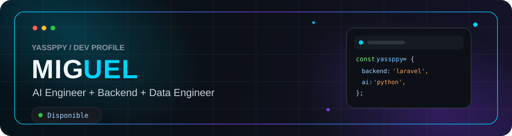

  

## 👋 Sobre Mí

Ingeniero de Sistemas especializado en automatización de procesos y optimización de flujos de trabajo para maximizar la eficiencia y la productividad. Me distingue mi alta capacidad de adaptación y una búsqueda constante de innovación y crecimiento.

### 🌱 **Actualmente:**

- **Explorando:** Inteligencia Artificial, LangGraph y la nube con AWS.
- **Enfoque:** Construir soluciones de alto impacto e impulsar el trabajo colaborativo en equipo.

### 📫 Contacto: &nbsp;  &nbsp; 

---

## 🛠️ Stack Tecnológico

### Backend & APIs

  
  
  
  

### Data & Databases

  
  
  

### Cloud & DevOps

  

---

## 🚀 Proyectos Destacados

| Proyecto                                                                             | Descripción                                                                          | Tecnologías                                                                                                                                                                                                                                                                                                                                                        |
| :----------------------------------------------------------------------------------- | :----------------------------------------------------------------------------------- | :----------------------------------------------------------------------------------------------------------------------------------------------------------------------------------------------------------------------------------------------------------------------------------------------------------------------------------------------------------------- |
| ⚡ **[Nubecont Automatización](https://github.com/yassppy/nubecont-automatizacion)** | Reducción de 30 a 10 min en extracción de comprobantes y validación RUC en SUNAT.    |       |
| 📊 **[ETL de Ventas](https://github.com/yassppy/databricks_ventas)**                 | Pipeline ETL optimizado (30 a 10 min) hasta la creación de dashboards en Databricks. |                                                                                                                        |
| 🤖 **[Agente VerdeFIT Pedidos](https://github.com/yassppy/agent_verdefit_pedidos)**  | Sistema orquestador multi-agente para automatización de toma de pedidos.             |    |

---

## 📊 Estadísticas de GitHub

